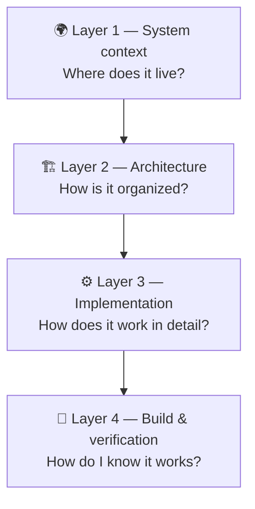

# 🗺️ Step 2 — Discover

> [!abstract] TL;DR
> Survey the system before you study the technology. Ask: **"Which parts of the system must I understand to make the right technical decisions?"**

Prev: [[01 Clarify]] · Next: [[03 De-risk]]

---

## 1. Learn for the problem, not for the textbook

After you understand the problem, don't ask *"How long do I need to learn this framework?"*

Ask:

> [!question] Which parts of the system do I need to understand to make the right technical decisions?

That is the difference between learning a technology **from a textbook** and learning it **to solve a problem**.

## 2. Survey in four layers



> [!tip] A general mindset, not only for software
> When facing a complex system, don't jump into the details. Go **context → structure → components → operation**. Every time you meet a new system, ask:
> 1. In what **context** does it exist?
> 2. How is it **organized**?
> 3. How does it **work** in detail?
> 4. How do I **know** it works correctly?

### 🚗 Example 1 — Embedded: a new automotive ECU

| Layer | Questions |
| --- | --- |
| **1 Context** | Where is this ECU in the vehicle? Which CAN bus? Which sensors feed it? What does it control? |
| **2 Architecture** | Which tasks run on the RTOS? Which driver manages CAN? Which software component (SWC) holds the logic? |
| **3 Implementation** | Where is the source? Which CAN callback is called? Which state machine handles the request? |
| **4 Validation** | HIL test? Unit tests? Real vehicle? Requirements traceability? |

### 🏭 Example 2 — A manufacturing line

| Layer | Questions |
| --- | --- |
| **1 Context** | What product does it make? Which stage of the plant is it? |
| **2 Architecture** | Which machines exist? How does material flow? |
| **3 Implementation** | How is each machine operated? What are the parameters? |
| **4 Validation** | Quality standards? Output KPIs? Defect rate? |

### 🏢 Example 3 — Joining a new company

| Layer | Questions |
| --- | --- |
| **1 Context** | How does the company make money? |
| **2 Structure** | How do the departments connect? |
| **3 Execution** | What does my team do? What are the processes? |
| **4 Measurement** | What are the KPIs? How is success measured? |

### 🤖 Example 4 — A RAG system

See [[RAG]] for a worked example of the four layers on an AI project.

> [!quote] Why seniors think this way
> Seniors rarely ask *"How is this function written?"* They ask:
> - "Where does this module sit in the system?"
> - "Who calls it?"
> - "If we change this, what is affected?" *(this is **impact analysis**)*
> - "How do we prove this change is safe?"

## 3. Trace one end-to-end flow

Suppose you must add a data-processing feature. Don't read every class. Trace **one** flow:

```
Input → Parser → Business Logic → Output
```

Find out:

- Where does the data come from?
- Who validates it?
- Where does the business logic live?
- Which module owns the data?
- How are errors propagated?
- Where does the result go?

Once you understand **one flow**, you have a first map of the system. Then go deeper into the modules your task touches.

## 4. Separate "must learn" from "must know it exists"

Say the framework has 30 features but your task uses only 4.

| Category | Meaning |
| --- | --- |
| 🔴 **Must understand** | Deep enough to implement correctly |
| 🟡 **Need to know** | Know it exists and where to look it up |
| ⚪ **Out of scope** | No research needed for this task |

> [!warning] Tutorial hell
> Without this rule you read a lot, feel like you understand a lot, and still produce nothing you can verify.

---

## 🔗 PMBOK link

| PMBOK 6th | How it matches |
| --- | --- |
| **Enterprise Environmental Factors (EEF)** | The OS, toolchain, hardware, standards you must live with |
| **Organizational Process Assets (OPA)** | Existing repos, templates, past lessons learned |
| **Collect Requirements** (Planning) | Interviews and document analysis give you the system view |
| **Knowledge areas** | Integration, Scope |

| PMBOK 7th | How it matches |
| --- | --- |
| **Systems thinking** principle | See the whole system and how parts interact (the four layers) |
| **Complexity** principle | Don't try to learn everything at once |

## 🧠 Remember

> **Context → Structure → Components → Operation.**
> Trace **one** flow before reading many files.
> Sort topics into **Must / Need to know / Out of scope**.
