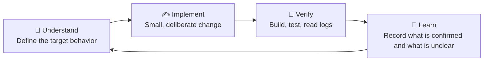

# 🛠️ Step 5 — Implement

> [!abstract] TL;DR
> Learn **just in time**, code **within scope**. You don't need to understand everything before you start, but you must not code without understanding what can affect correctness.

Prev: [[04 Plan]] · Next: [[06 Validate]]

---

## 1. Work in small loops

**Example:** you don't know the framework's callback mechanism. Don't write the business logic, change the threading, **and** add dependency injection in one change. Build a **minimal example** to understand the callback lifecycle, verify it, then apply it to the real module.

**Benefit:** when something breaks, you know which change caused it.

## 2. Separate fact, assumption, verified

Keep a short list while you work:

| Type | Example |
| --- | --- |
| 📗 **Fact** | The framework provides a callback when new data arrives. |
| 📙 **Assumption** | The callback always runs on a separate thread. |
| 📘 **Verified** | The log shows the callback runs on the event-loop thread. |
| ❓ **Open question** | How are pending callbacks handled during shutdown? |

> [!warning] Why it matters
> Early guesses slowly turn into "facts" in your head. In **embedded** work, assumptions about **threads, interrupts, buffer ownership, memory lifetime and timing** cause bugs that are very hard to reproduce.

---

## 🔗 PMBOK link

| PMBOK 6th | How it matches |
| --- | --- |
| **Direct and Manage Project Work** (Executing) | Do the planned work, produce deliverables |
| **Manage Quality** | Build quality in: reviews, tests, standards |
| **Manage Project Knowledge** | Write down what you learn (the "Learn" step) |
| **Manage Communications** | Keep stakeholders informed |
| **Assumption Log** | Your "assumption" and "verified" rows |
| **Issue Log** | Your "open question" and blockers |
| **Lessons Learned Register** | Notes from each loop |
| **Knowledge areas** | Integration, Quality, Communications |

| PMBOK 7th | How it matches |
| --- | --- |
| **Project Work** domain | Run the work, manage information and learning |
| **Quality** principle | Build quality into the process, not just the end |

## 🧠 Remember

> **Understand → Implement → Verify → Learn.**
> One small change at a time.
> Keep **Fact / Assumption / Verified / Open question** separate.
