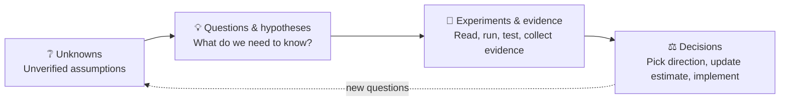

# 🧭 Managing Uncertainty and Core Principles

> [!abstract] TL;DR
> A new project is **decision-making with incomplete information**. Treat it as a loop that reduces uncertainty, and focus on the unknowns that can change a decision.

Prev: [[09 Communication]] · Back to: [[Thinking New project]]

---

## 1. The uncertainty loop

You don't yet know exactly:

- Which solution will work
- Which part will take the most time
- Which assumption will turn out wrong
- Whether integration will hit obstacles
- Whether the first design must change

## 2. Not every unknown needs solving now

| Type of unknown | Action |
| --- | --- |
| Doesn't affect the current decision | Park it |
| May delay implementation | Schedule it |
| **If found too late, causes very costly rework** | **Do it first** |

> [!example]
> Not understanding a helper API is probably fine. Not knowing whether the framework runs on the target could force you to redo the **whole plan**.

Experienced people focus on the **questions that can change decisions**, not on closing every knowledge gap.

## 3. The five principles

> [!success] The 5 habits
> 1. 🧠 **Understand before optimizing** — grasp the problem and constraints first.
> 2. 🔬 **Investigate before assuming** — separate facts from assumptions; verify what matters.
> 3. 🎯 **Test the riskiest assumption first** — before a big investment.
> 4. 📦 **Deliver evidence, not just activity** — produce verifiable results.
> 5. 📣 **Communicate uncertainty early** — report unknowns, blockers and risks before they become schedule problems.

> [!note] One caveat: tailor the process
> Not every small task needs all six steps. For a **small, reproducible bug** in a familiar codebase, go straight to debugging and testing. Use the full process when the **scope is large, the technology is new, there are many dependencies, or mistakes are costly**.

## 4. The mindset upgrade

Change the question:

| ❌ From | ✅ To |
| --- | --- |
| "What do I need to **learn** to do this task?" | "What do I need to **verify** to know which approach is correct, feasible and lowest-risk?" |

It may not make you code faster on day one, but it saves many hours of working in the wrong direction on larger projects.

---

## 🔗 PMBOK link

| Habit | PMBOK 6th | PMBOK 7th |
| --- | --- | --- |
| 1. Understand before optimizing | Define Scope, Collect Requirements | *Value*, *Systems thinking* |
| 2. Investigate before assuming | Assumption Log, Identify Risks | *Risk* |
| 3. Riskiest assumption first | Qualitative Risk Analysis, Plan Risk Responses | Uncertainty domain |
| 4. Evidence, not activity | Control Quality, Validate Scope | Delivery, Measurement domains |
| 5. Communicate early | Manage Communications, Issue Log, Escalate | Stakeholder domain |
| Tailor the process | Tailoring (PMBOK 6th: "tailor the processes") | *Tailoring* principle |

The loop above matches the 7th-ed. **Uncertainty** domain (ambiguity, complexity, volatility, uncertainty, risk). See [[PMBOK Mapping]] for the full map.

## 🧠 Remember

> **Unknowns → Questions → Experiments → Decisions → (repeat).**
> Do first the unknowns that are **costly if found late**.
> Ask "what do I need to **verify**?", not "what do I need to **learn**?".
