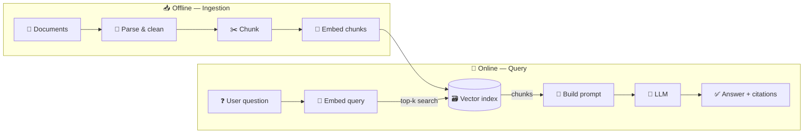
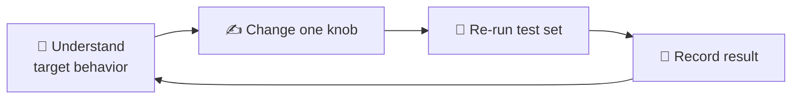

---

title: Implementing RAG — A Worked Example Using the New-Project Framework aliases:

- RAG Worked Example
- RAG Project Kickoff
- Implement RAG from Zero tags:
- rag
- llm
- engineering
- project-management
- worked-example type: playbook status: draft created: 2026-10-20 related:
- "[[Approaching a Brand-New Project]]"
- "[[RAG]]"

---

# 🤖 Implementing RAG — A Worked Example

> [!abstract] Purpose A concrete example of applying the 6-step framework from [[Approaching a Brand-New Project]] (**Clarify → Discover → De-risk → Plan → Implement → Validate**) to the task _"implement RAG for our current project"_, starting from zero RAG knowledge.

> [!note] About the example The project domain is unknown, so this uses an **internal engineering-docs Q&A assistant** as the scenario. Replace the details with your own project's.

---

## 📚 0. What Is RAG? (60-second primer)

An LLM does not know your private documents. **RAG (Retrieval-Augmented Generation)** fixes this:

1. 🔎 **Retrieve** — search your documents for the passages relevant to the question.
2. 🧩 **Augment** — paste those passages into the prompt.
3. ✍️ **Generate** — the LLM answers _from those passages_ and can cite them.

> [!tip] PlantUML user? The same pipeline in PlantUML is easy to redraw: two packages (_Offline: ingestion_, _Online: query_) sharing one `database "Vector index"` node.

---

## 🔍 1. Clarify

> [!important] Requirement vs solution _"We need RAG"_ is a **solution**. The underlying problem is probably _"engineers waste time finding answers in specs and wikis."_ Ask what the real problem is — **plain keyword search might already be enough**.

### ❓ Questions to take to your boss

- [ ] Who asks the questions, and what are **10 real examples**?
- [ ] What documents are involved (PDF, wiki, code, tables, scans)? How many? How often do they change?
- [ ] Which languages (English, Vietnamese, both)?
- [ ] Must it run **on-prem / offline**, or may it call a cloud LLM?
- [ ] What should it do when the answer isn't in the documents?
- [ ] Must every answer **cite its source**?
- [ ] Are there **access restrictions** on some documents?

### 📝 Example project brief

|Item|Example|
|---|---|
|🎯 **Objective**|Engineers get sourced answers to spec questions in under 10 s|
|🔲 **Scope**|Ingest PDFs and wiki pages; Q&A only. No editing, no agent actions|
|🚧 **Constraints**|On-prem only, one GPU box, 2-month timeline|
|✅ **Acceptance criteria**|≥ 80% of 50 real questions answered correctly with the right citation; says "not found" otherwise|
|❓ **Open questions**|Scanned PDFs? Vietnamese content? Access control?|
|💭 **Assumptions**|Docs are mostly text-based PDFs|

---

## 🗺️ 2. Discover

### Four layers applied to RAG

|Layer|Questions|
|---|---|
|🌍 **1 — Context**|Who uses it? Where do the answers live today?|
|🏗️ **2 — Architecture**|The pipeline above: ingest → chunk → embed → index → retrieve → generate|
|⚙️ **3 — Implementation**|Which parser, embedding model, vector store, LLM?|
|🧪 **4 — Validation**|How do we know an answer is right? → a **test question set**|

> [!example] Trace ONE flow by hand Take one real question, find the paragraph that answers it, and write down what a _perfect_ system would retrieve. This is the "trace one end-to-end path" exercise.

### Learning scope

|Category|Topics|
|---|---|
|🔴 **Must understand**|Chunking · embeddings & similarity search · top-k retrieval · prompt grounding · evaluation|
|🟡 **Need to know exists**|Reranking · hybrid search (keyword + vector) · query rewriting|
|⚪ **Out of scope (for now)**|Fine-tuning · agents · multi-modal input|

---

## 🛡️ 3. De-risk

$$ Risk \approx Impact \times Uncertainty $$

|Assumption|Impact|Uncertainty|Priority|
|---|---|---|---|
|Our documents parse cleanly (tables, scans)|🔴 High|🔴 High|🔥 **Very high**|
|Retrieval finds the right chunk|🔴 High|🔴 High|🔥 **Very high**|
|Embedding model handles our terms / Vietnamese|🔴 High|🟡 Medium|🟠 High|
|LLM fits our hardware and privacy rules|🔴 High|🟡 Medium|🟠 High|
|Which vector database to use|🟢 Low|🟢 Low|🟢 Low _(swappable later)_|

### 🧪 Spike example

|Element|Definition|
|---|---|
|❓ **Question**|Does a naive RAG setup answer 10 real questions from 20 real documents?|
|🔨 **Build**|Parse → chunk (~500 tokens) → embed → simple local index → retrieve top-5|
|✅ **Success**|Correct passage in the top-5 for ≥ 7 of 10 questions _(example numbers — agree on yours with the team)_|
|⏱️ **Timebox**|2–3 days|

> [!tip] A failed spike is still valuable. If parsing fails, you've learned the real problem is **document cleaning**, not the LLM.

---

## 📋 4. Plan

|Milestone|Focus|Deliverable|
|---|---|---|
|**M1** 🔬|Feasibility|Test question set + spike results + risk report|
|**M2** 🍰|Vertical slice|One document type end-to-end, answers with citations|
|**M3** ⚙️|Functional|More formats, hybrid search or reranking, incremental re-indexing|
|**M4** 🛡️|Hardening|Regression evaluation, access control, latency & resource checks, docs|

---

## 🛠️ 5. Implement

> [!important] One knob at a time Change **one** thing (chunk size, top-k, embedding model, prompt), then **re-run the test set**.

### Fact / Assumption / Verified log

|Type|Example|
|---|---|
|📗 **Fact**|The embedding model returns 768-dimensional vectors|
|📙 **Assumption**|Chunks of 500 tokens keep a table intact|
|📘 **Verified**|Test set shows tables get split mid-row → chunk by section instead|
|❓ **Open question**|How should re-indexing handle deleted documents?|

---

## ✅ 6. Validate

> [!warning] Measure retrieval and generation **separately** Most "the LLM is bad" complaints turn out to be _"retrieval returned the wrong chunk."_

- [ ] **Retrieval** — was the right chunk in the top-k? (_recall@k_)
- [ ] **Generation** — is the answer grounded in the retrieved text?
- [ ] **Refusal** — does it say _"not found"_ when it should?
- [ ] **System** — latency, memory and GPU use
- [ ] **Regression** — re-run the test set after every change

---

## 🕳️ RAG-Specific Pitfalls

> [!failure]- Tuning prompts before checking retrieval If the right chunk never reaches the prompt, no prompt wording can fix it. Check retrieval first.

> [!failure]- Picking a vector database or framework first This is a low-impact decision. Build the test set before choosing tools.

> [!failure]- No test questions Without a test set, _"it seems good"_ is your only evidence — and you can't tell whether a change helped.

> [!failure]- Skipping document cleaning Bad parsing makes the model look worse than it is.

---

## 🚀 Your First Three Days

1. [ ] Collect **20–30 real questions** from the people who'd use it, with the passage that answers each.
2. [ ] Gather **20 representative documents** and check how well they parse.
3. [ ] Write the **one-page brief** from step 1 and send it to your boss with the open questions.

> [!quote] Suggested message to your boss _"I haven't built a RAG system before, so I'll first collect real questions and sample documents, run a small feasibility spike, and identify the major risks. Once I have that initial assessment, I'll propose a more reliable plan and estimate."_

---

## 🔗 Related Notes

- [[Approaching a Brand-New Project]]
- [[RAG]]
- [[Technical Spike Template]]
- [[Risk Register]]
- [[RAG Test Question Set]]