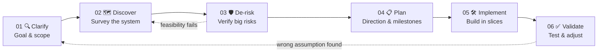

# 🧭 Approaching a Brand-New Project in a Professional Environment

> [!abstract] TL;DR
> The most important thing is **not** to start learning the technology right away. It is to:
>
> 1. 🎯 **Identify the right problem**
> 2. 📉 **Reduce uncertainty**
> 3. 🛤️ **Find a feasible path to finish the project**
>
> An experienced engineer doesn't need to know every technology. The difference is in **how they handle what they don't know**.

This folder is the study guide. Each step has its own note and a **PMBOK link** (6th + 7th edition). Start here, then follow the links.

---

## 📌 Scenario

Your manager assigns you a project that uses a **new C++ framework**, runs on **Linux**, and talks to a **hardware device** you have never touched.

| # | Archetype | Approach | Verdict |
| --- | --- | --- | --- |
| 1 | 🐣 **The Newcomer** | Read the framework docs cover to cover, learn everything, *then* start | ❌ Slow, unfocused (tutorial hell) |
| 2 | 🔧 **The Task-Taker** | Open the source, find where to edit, hack until it runs | ⚠️ Fast start, fragile result |
| 3 | 🧠 **The Systems Thinker** | Clarify the outcome → survey the architecture → identify the biggest risks → verify feasibility → *then* plan | ✅ Best for projects with many unknowns |

> [!note]
> Approach 3 doesn't mean skipping learning or jumping straight to system design. It means **learning and designing in the order of the project's priorities**, not in the order topics appear in the documentation.

---

## 1️⃣ Three types of uncertainty

Starting a new project feels like *"I know nothing."* But that feeling mixes different problems, and each needs its own treatment.

| Type | Meaning | What to do |
| --- | --- | --- |
| 🟦 **Problem uncertainty** | The problem is unclear: what to solve, what the output is, what success means | Ask stakeholders, read requirements, confirm acceptance criteria |
| 🟧 **Technical uncertainty** | The goal is clear but the technology or architecture is not | Read the source, survey the architecture, build a prototype or spike |
| 🟩 **Execution uncertainty** | The delivery path is unclear: order, dependencies, time, testing | Build a dependency map, split into milestones, identify people and resources |

> [!important] Key point
> **Don't use one method to resolve all three types.**

> [!warning]
> If you dive into learning a framework while the problem is still vague, you may become an expert in something the project doesn't actually need.

> [!info] PMBOK note
> These three labels are **this guide's own** (analogy to the 7th-ed. *Uncertainty* domain), not official PMBOK terms. See [[PMBOK Mapping]].

---

## 2️⃣ The six-step process

> [!info]
> This is **not** a rigid, linear process. When you find a wrong assumption, go back to an earlier step.

> [!tip] Remember
> **C-D-D-P-I-V** → *Clarify, Discover, De-risk, Plan, Implement, Validate.*

| Step | Note | Core question | PMBOK 6th (main) | PMBOK 7th |
| --- | --- | --- | --- | --- |
| 01 | [[01 Clarify]] | What problem? What is "done"? | Initiating, Scope, Stakeholder | Stakeholder, *Value* |
| 02 | [[02 Discover]] | What must I understand? | EEF / OPA, Collect Requirements | *Systems thinking* |
| 03 | [[03 De-risk]] | What could kill the project? | Risk Management | Uncertainty, *Risk* |
| 04 | [[04 Plan]] | What order? What depends on what? | Schedule, WBS | Planning |
| 05 | [[05 Implement]] | How do I build safely? | Executing, Quality | Project Work |
| 06 | [[06 Validate]] | How do I prove it works? | Control Quality, Validate Scope, Closing | Delivery, Measurement |

---

## 📚 Study path

**Core steps**
1. [[01 Clarify]]
2. [[02 Discover]] (with the worked example [[RAG]])
3. [[03 De-risk]]
4. [[04 Plan]]
5. [[05 Implement]]
6. [[06 Validate]]

**Supporting notes**
- [[07 Approaches]] — top-down, bottom-up, spike, incremental
- [[08 Pitfalls]] — 8 mistakes to avoid
- [[09 Communication]] — what to say to your manager
- [[10 Uncertainty and Principles]] — the uncertainty loop and 5 habits

**Reference and tools**
- [[PMBOK Mapping]] — the bridge to PMBOK 6th and 7th
- [[Glossary]] — project management English
- [[Project Onboarding Checklist]] — day-one checklist
- [[Risk Register]] — template
- [[Technical Spike Template]] — template

---

## 🎯 The 5 habits (one-line version)

1. 🧠 **Understand before optimizing**
2. 🔬 **Investigate before assuming**
3. 🎯 **Test the riskiest assumption first**
4. 📦 **Deliver evidence, not just activity**
5. 📣 **Communicate uncertainty early**

Details: [[10 Uncertainty and Principles]].

> [!tip] 🚀 The mindset upgrade
> Change the question from **"What do I need to learn to do this task?"** to **"What do I need to verify to know which approach is correct, feasible and lowest-risk?"**
