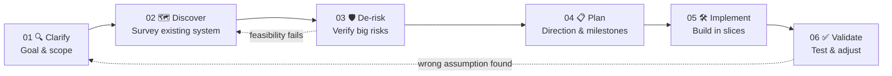
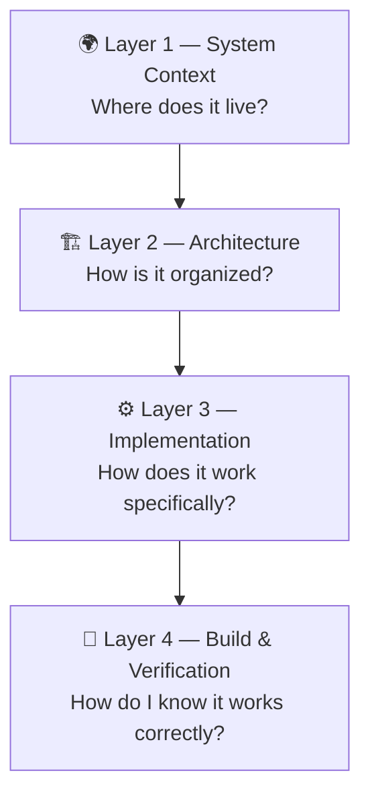
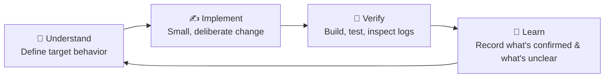
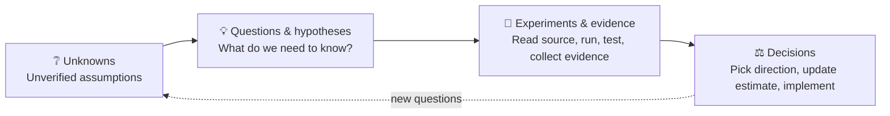

---

title: Approaching a Brand-New Project in a Professional Environment aliases:

- New Project Mindset
- Uncertainty Management
- Project Onboarding Playbook tags:
- engineering
- mindset
- project-management
- embedded
- onboarding type: playbook status: evergreen created: 2026-10-20

---

# 🧭 Approaching a Brand-New Project in a Professional Environment

> [!abstract] TL;DR The most important thing is **not** to start learning the technology right away. It is to:
> 
> 1. 🎯 **Identify the right problem**
> 2. 📉 **Reduce uncertainty**
> 3. 🛤️ **Find a feasible path to finish the project**
> 
> An experienced engineer doesn't need to know every technology. The difference is in **how they handle what they don't know**.

---

## 📌 Scenario

Your boss assigns you a project that uses a **new C++ framework**, runs on **Linux**, and talks to a **hardware device** you've never touched.

There are three common approaches:

|#|Archetype|Approach|Verdict|
|---|---|---|---|
|1|🐣 **The Newcomer**|Read the framework docs cover to cover, learn everything, _then_ start|❌ Slow, unfocused (tutorial hell)|
|2|🔧 **The Task-Taker**|Open the source, find where to edit, hack until it runs|⚠️ Fast start, fragile result|
|3|🧠 **The Systems Thinker**|Clarify the outcome → survey the architecture → identify the biggest risks → verify feasibility → _then_ plan|✅ Best for projects with many unknowns|

> [!note] Approach 3 doesn't mean skipping learning or jumping straight to system design. It means **learning and designing in the order of the project's priorities**, not in the order topics appear in the documentation.

**Methods covered in this note:**

- 🔄 Thinking process
- ❓ How to ask questions
- 📊 How to evaluate a project
- 🧰 Different approaches
- 🕳️ Common pitfalls

---

## 1️⃣ First, Distinguish 3 Types of Uncertainty

Receiving a new project often feels like _"I know nothing."_ But that feeling bundles together several different problems, and each needs its own treatment.

### 🟦 Problem uncertainty — _the problem is unclear_

- What exactly needs to be solved?
- What is the output?
- What criteria define success?

### 🟧 Technical uncertainty — _the solution is unclear_

- You know the goal but not the technology?
- What architecture or implementation fits?

### 🟩 Execution uncertainty — _how to get it done is unclear_

- In what order should things be done?
- What are the dependencies?
- How much time is needed, and how will it be tested?

> [!important] Key point **Don't use one method to resolve all three types of uncertainty.**

|Uncertainty|What to do|
|---|---|
|🟦 Problem unclear|Ask stakeholders, read requirements, confirm acceptance criteria|
|🟧 Technical unclear|Read the source, survey the architecture, build a prototype|
|🟩 Execution unclear|Build a dependency map, split into milestones, identify people and resources needed|

> [!warning] If you dive into learning a framework while the problem is still vague, you may become an expert in something the project doesn't actually need.

---

## 2️⃣ The Overall Process: From Receiving the Task to Confident Delivery

A suggested process for a new project of **medium-to-high complexity**.



> [!info] This is **not** a rigid linear process. When you discover a wrong assumption, go back to an earlier step.

---

## 3️⃣ Step 1 — 🔍 Clarify: Don't Rush to Solve What You Don't Understand

When the boss hands over a project, many engineers' first instinct is to ask:

- Which framework should we use?
- Is there documentation?
- Is there sample code?
- Where do I start coding?

These are reasonable questions, but **not the most important ones**. Before figuring out _how to build it_, clarify **what problem we are solving** and **what success looks like**.

### 3.1 The Five Questions

| Question            | What you need to determine                                         |
| ------------------- | ------------------------------------------------------------------ |
| ❓ **Why?**          | Why does this project exist? What is the current problem?          |
| 🎁 **What?**        | What is the concrete output to deliver?                            |
| 🔲 **Scope?**       | What is your responsibility, and what is not?                      |
| 🚧 **Constraints?** | Deadline, hardware, OS, RAM, CPU, compatibility, coding standards? |
| 🏁 **Done?**        | What condition proves the project is complete?                     |

**Example:** the boss asks you to build a service on embedded Linux that receives data from a peripheral device. Don't just write the requirement as _"Implement communication service"_. Clarify:

- [ ] What kind of data does the service receive?
- [ ] Is communication over UART, SPI, TCP, or an existing API?
- [ ] Are there latency or throughput guarantees?
- [ ] What should happen if the device disconnects?
- [ ] May the service restart? Who manages its lifecycle?
- [ ] Test on real hardware, or must simulation be supported?
- [ ] Must it be compatible with the existing system's API?

> [!tip] You don't need every answer right away. The goal is to separate **what is clear**, **what is unclear**, and **what could make the project fail if misunderstood**.

### 3.2 Distinguish Requirement from Solution

This is a very important skill. Suppose the boss says:

> _"We need to introduce a new framework to handle asynchronous communication."_

That is a **solution request**, not necessarily the **root problem**. Find out:

- What problem is the current system having?
- Is latency too high?
- Are there too many threads?
- Is lifecycle management difficult?
- Or is the old framework no longer supported?

**Why it matters:** if you assume the stated solution is optimal, you may spend weeks integrating a complex framework when the real problem only needed a simple event-driven mechanism.

Of course, in a corporate setting the framework may already be an **architecture decision approved by management**. You don't have to push back, but you should still understand the goal to implement correctly and spot risks.

> [!quote] Principle **Requirement** tells you what the system must achieve; **solution** is one way to achieve it.

### 3.3 Output of This Step

Before moving on, write a short summary:

- 🎯 **Objective**
- 🔲 **Scope**
- 🚧 **Constraints**
- ✅ **Acceptance criteria**
- ❓ **Open questions**
- 💭 **Assumptions** (what you're temporarily assuming)

---

## 4️⃣ Step 2 — 🗺️ Discover: Survey the System Before Learning the Technology

After understanding the problem, the next question is **not** _"How long do I need to learn this framework?"_ but:

> [!question] **Which parts of the system do I need to understand to make the right technical decisions?**

This is the difference between learning a technology **from a textbook** and learning it **to solve a problem**.

### 4.1 Survey in Layers



> [!tip] Layered thinking is a _general_ mindset, not just for software It comes from a very general principle: when facing a complex system, don't jump into details. Go **context → structure → components → operation**.
> 
> Whenever you meet a new system, ask:
> 
> 1. Which **context** does it exist in?
> 2. How is it **organized**?
> 3. How does it **work** specifically?
> 4. How do I **know** it is working correctly?

#### 🚗 Example 1: Embedded System (a new automotive ECU)

|Layer|Questions|
|---|---|
|**1 — System Context**|Where is this ECU in the vehicle? Which CAN bus does it talk to? Which sensors feed it? What does it control?|
|**2 — Architecture**|Which tasks run on the RTOS? Which driver manages CAN? Which SWC handles the logic?|
|**3 — Implementation**|Where is the source code? Which CAN callback gets called? Which state machine handles requests?|
|**4 — Validation**|HIL testing? Unit tests? Real vehicle? Requirement traceability?|

#### 🏭 Example 2: A Manufacturing Line

|Layer|Questions|
|---|---|
|**1 — Context**|What product does this line make? Where is it in the overall plant flow?|
|**2 — Architecture**|Which machines exist? How does material flow?|
|**3 — Implementation**|How is each machine operated? What are the technical parameters?|
|**4 — Validation**|Quality standards? Output KPIs? Defect rate?|

#### 🏢 Example 3: Joining a New Company

|Layer|Questions|
|---|---|
|**1 — Context**|How does the company make money?|
|**2 — Structure**|How do departments connect?|
|**3 — Execution**|What does my team do? What are the concrete processes?|
|**4 — Measurement**|What are the KPIs? How is success measured?|

#### 🤖 Example 4: [[RAG]]

> [!todo] To fill in Apply the four layers to a RAG system:
> 
> - **Layer 1 — Context:** _…_
> - **Layer 2 — Architecture:** _…_
> - **Layer 3 — Implementation:** _…_
> - **Layer 4 — Validation:** _…_

> [!quote] Why seniors think this way If you grow into a **Tech Lead / System Architect**, you'll notice seniors rarely ask _"How is this function written?"_ Instead they ask:
> 
> - _"Where does this module sit in the system?"_
> - _"Who calls it?"_
> - _"If we change this, which components are affected?"_
> - _"How do we prove this change is safe?"_
> 
> That is layer-based thinking at work.

### 4.2 Find a Path Through the Source Code

Suppose you're asked to add a data-processing feature. Instead of reading every class, **trace one specific flow**:

```
Input → Parser → Business Logic → Output
```

Find answers to:

- Where does data come in from?
- Who is responsible for validation?
- Where does the business logic live?
- Which module owns the data?
- How are errors propagated?
- Where are results sent?

Once you understand **one end-to-end flow**, you have an initial map of the system. Only then dig deeper into modules directly related to your task.

### 4.3 Separate What to Learn from What to Merely Know Exists

Say the framework has 30 features, but your task uses only 4 main ones.

|Category|Meaning|
|---|---|
|🔴 **Must understand**|Understand deeply enough to implement correctly|
|🟡 **Need to know**|Know it exists, know where to look it up when needed|
|⚪ **Out of scope**|No need to research for this task|

> [!warning] Tutorial hell Without this principle, you easily fall into **tutorial hell**: reading a lot, feeling like you understand a lot, but producing nothing verifiable.

---

## 5️⃣ Step 3 — 🛡️ De-risk: Find What Could Make the Project Fail First

This step best reveals an experienced engineer's mindset. When you know little about a project, you can't be sure the whole design is right, but you **can** proactively find the most dangerous assumptions and verify them early.

### 5.1 Risk ≠ Hard Task

A task can be hard but low-risk (stable technology, good docs, someone has done it before). Conversely, a task that looks simple can be very risky if it depends on a library not yet verified on the target.

Examples of risk questions:

- Does the framework run on the **target's Linux version**?
- Does the library support the device's **CPU architecture**?
- Does the API meet the **latency limits**?
- Does it **build with the project's toolchain**?
- Does it depend on a **license** or library that isn't permitted?
- Is it **compatible** with the existing system?

These questions can change the entire implementation plan.

### 5.2 Assess Risk by Impact × Uncertainty

$$ Risk \approx Impact \times Uncertainty $$

- **Impact:** if the assumption is wrong, how big are the consequences?
- **Uncertainty:** how confident are you in that assumption right now?

> [!note] This is a pragmatic prioritization model, **not** a standard quantitative risk formula for every project.

|Assumption|Impact if wrong|Uncertainty|Verification priority|
|---|---|---|---|
|Framework builds on target|🔴 High|🔴 High|🔥 **Very high**|
|API meets concurrency requirements|🔴 High|🔴 High|🔥 **Very high**|
|Name of a helper function|🟢 Low|🔴 High|🟢 Low|
|A small code snippet can be optimized|🟢 Low|🟡 Medium|🟢 Low|

> [!important] Key point Don't prioritize the question that's **easiest** to answer. Prioritize the question whose answer is **most likely to change the biggest decision**.

### 5.3 Use a Spike or Prototype to Reduce Risk

A **technical spike** is a time-boxed technical investigation that answers one specific question. It is not necessarily production-ready.

> **Question:** Can Framework X run on our Linux target and receive data asynchronously?

A spike may only need to:

1. Create a minimal program.
2. Build with the real toolchain.
3. Run on the target or an equivalent environment.
4. Try a basic communication flow.
5. Observe logs, resource usage, and necessary failure behavior.
6. Record the results and limitations discovered.

You don't need full architecture, logging, configuration, or every production feature yet.

**A good spike has a clear question and a clear exit condition:**

|Element|Example|
|---|---|
|❓ Question|Does it build with the current toolchain?|
|✅ Success|Sample program builds and runs on target|
|❌ Failure|Incompatibility identified, alternative proposed|
|⏱️ Timebox|A duration agreed with the team in advance|

> [!tip] Even if the prototype fails, it's valuable if it helps you **eliminate an infeasible direction early**.

---

## 6️⃣ Step 4 — 📋 Plan: Choose a Direction Before Breaking Down the Work

Once you have initial understanding and have verified the key risks, build a more detailed plan. Avoid two extremes:

- ❌ Extremely detailed planning with insufficient information
- ❌ No planning at all: "just code and figure it out"

The sensible way is to **plan according to the level of certainty**.

### 6.1 Split Work into Milestones

Example: integrating a new framework into an existing embedded system.

|Milestone|Focus|Description|Deliverable|
|---|---|---|---|
|**M1**|🔬 Feasibility|Confirm toolchain, dependencies, ability to build and run on target|Feasibility report and remaining risks|
|**M2**|🍰 Vertical slice|Implement a minimal flow from input to output using the new framework|A runnable, testable end-to-end flow|
|**M3**|⚙️ Functional implementation|Complete features, error handling, configuration, integration with related modules|Functionality meeting requirements|
|**M4**|🛡️ Hardening & delivery|Test edge cases, errors, concurrency, resource usage, regression; documentation|Release meeting acceptance criteria|

The benefit: you don't need to know exactly how to implement M4 when starting M1. You only need enough information to determine the direction, completion criteria, and main risks of the **current** milestone.

### 6.2 Choose a Vertical Slice Over Building Layer by Layer

A common planning mistake: build the entire framework integration first, then the business logic, and only at the end run on the target. At integration time you may discover the initial assumptions were wrong.

Instead, find a **vertical slice**: a small cut that passes through all the necessary layers.

```
Hardware/Input → Adapter → New Framework → Business Logic → Output
```

It doesn't need every feature. It only needs to be enough to confirm the components can work together.

> [!caution] Not every project should prototype the full flow immediately. For **safety-critical systems**, major architecture changes, or projects requiring **certification**, you may need formal analysis and approval steps before experimenting.

### 6.3 Don't Forget Dependencies

A task may be blocked not because you lack knowledge, but because:

- 🔌 No hardware yet
- 🔑 No repository access
- 👥 Another team hasn't finished their API
- 🧰 No toolchain
- 📄 No formal requirements
- 📊 No test data

Distinguish between:

- ✅ Work you can do **right now**
- ⏳ Work **dependent on another condition**
- 🙋 Work needing a **decision from management or a related team**

That's how you manage progress based on reality, not just the number of tasks.

---

## 7️⃣ Step 5 — 🛠️ Implement: Learn Just in Time, Code Within Scope

Once you have a plan, start building. The principle stays the same: you don't need to understand everything before starting, but you must not code without understanding what could affect correctness.

### 7.1 Use Small Loops



**Example:** if you're not familiar with the framework's callback mechanism, don't write all the business logic, change threading, _and_ add dependency injection in one edit. Create a **minimal example** to understand the callback lifecycle, verify it, then apply it to the real module. This makes debugging easier because you know which change caused which behavior.

### 7.2 Separate What You Know, Assume, and Have Verified

Keep a short list while working on a new project:

|Type|Example|
|---|---|
|📗 **Fact**|The framework provides a callback when new data arrives.|
|📙 **Assumption**|The callback always runs on a separate thread.|
|📘 **Verified**|Logs show the callback runs on the event loop's thread.|
|❓ **Open question**|How are pending callbacks handled during shutdown?|

> [!warning] This reduces the tendency for initial guesses to gradually become "facts" in your head. In **embedded** especially, assumptions about **threads, interrupts, buffer ownership, memory lifetime, and timing** can lead to bugs that are hard to reproduce.

---

## 8️⃣ Step 6 — ✅ Validate: Prove the Result, Not Just That the Code Runs

A project isn't done just because it builds or demos once. Verify results against the **acceptance criteria agreed from the start**.

Depending on the project, validation may include:

- [ ] Functional correctness
- [ ] Error handling and recovery
- [ ] Boundary conditions
- [ ] Concurrency and race conditions
- [ ] Performance, latency, and resource usage
- [ ] Integration and regression tests
- [ ] Rebuildability from a clean standard environment
- [ ] Documentation and handover readiness

> [!example] Embedded example A communication service that works well when the device connects normally does **not** prove it works correctly when the connection drops, malformed data arrives, or shutdown happens mid-operation.

**Every major risk should be tied to a suitable way of verifying it.**

- Biggest risk is a **memory leak**? Ordinary functional tests aren't enough.
- Biggest risk is **latency**? A test that only confirms data arrives isn't enough.

---

## 9️⃣ Different Approaches and When to Use Them

There is no single optimal process for every project. Choose the method based on the nature of the problem.

### 🔽 A. Top-down — Overall to Detail

Start with goals, architecture, modules, and data flow, then go into implementation.

- **Use when:** new project, large codebase, many modules, or unclear requirements.
- **Strength:** understand the context and avoid optimizing an unnecessary component.

### 🔼 B. Bottom-up — Components to System

Start from one API, library, driver, or small component to understand real behavior, then expand to the whole system.

- **Use when:** unfamiliar framework, tricky API, driver, or an issue reproducible in a small example.
- **Strength:** easy to verify behavior and isolate causes.

### 🧪 C. Spike / Experimental — Controlled Experimentation

Create a small experiment to verify a key technical assumption.

- **Use when:** missing information, new technology, uncertain compatibility or performance.
- **Strength:** gather evidence before major investment.

### 🔁 D. Incremental / Iterative — Build and Refine Gradually

Split work into verifiable pieces, get feedback, then adjust.

- **Use when:** requirements may change, many components, or continuous integration is needed.
- **Strength:** find problems early, lower the cost of late corrections.

> [!success] In practice, combine all four **Top-down** to orient → **Bottom-up** to understand components → **Spike** to reduce risk → **Incremental** to deliver.
> 
> This is a good combination for most software engineering projects involving new technology.

---

## 🔟 Pitfalls — Mistakes to Avoid

> [!important] This is the section to pay the most attention to. Many failures on new projects don't come from a lack of intelligence, but from **allocating time and attention in the wrong places**.

> [!failure]- Pitfall 1: Learning the technology before understanding the problem You read hundreds of pages but don't know which parts serve the real requirements. **Fix:** Write the goal and the technical questions to answer _before_ planning your learning. Every learning topic should answer a concrete project need.

> [!failure]- Pitfall 2: Reading code in file order You understand many individual classes but not the execution flow or which module owns the main responsibility. **Fix:** Start from the entry point, trace one end-to-end flow, then read the related components in depth.

> [!failure]- Pitfall 3: Choosing a solution before identifying constraints You design a beautiful architecture that doesn't fit RAM, toolchain, coding standards, latency, or compatibility requirements. **Fix:** Write down constraints explicitly and verify high-impact assumptions before locking in the architecture.

> [!failure]- Pitfall 4: Prototyping for too long The prototype keeps gaining features and becomes a second product that still doesn't solve the main requirement. **Fix:** Each spike has one or a few specific questions, a clear timebox, and stop criteria. Then decide: continue, change direction, or stop.

> [!failure]- Pitfall 5: Assuming without verifying For example, assuming an API is thread-safe, that a callback never fires after the object is destroyed, or that an operation always completes synchronously. **Fix:** Check documentation, implementation, tests, or runtime behavior. Record what's uncertain instead of guessing.

> [!failure]- Pitfall 6: Staying silent too long when blocked You spend days on a problem that depends on another team, but don't report it because you think you must solve it yourself. **Fix:** Report early: the problem, its impact, what you've tried, and the decision you need help with. Autonomy doesn't mean doing everything alone.

> [!failure]- Pitfall 7: Promising a deadline before knowing enough You estimate by gut feeling or by learning time, ignoring integration, testing, and dependencies. **Fix:** Separate the known from the unknown. Give a rough estimate first, then update as spikes and surveys reduce uncertainty.

> [!failure]- Pitfall 8: Focusing on code instead of outcomes You make many commits but have no evidence the feature meets requirements. **Fix:** Tie each milestone to a deliverable and verification criteria. Measure progress by confirmed results, not volume of code.

---

## 1️⃣1️⃣ Communicating with Your Boss Professionally

A professional engineer doesn't need to pretend to know everything. What matters is clearly presenting your **level of understanding, handling plan, and risks**.

### 🅰️ Situation A — You don't fully understand the requirement

Instead of just saying _"I don't understand the requirement,"_ clarify the decision point:

> [!quote] Suggested wording _"I understand the overall objective. I'd like to clarify a few details about the expected behavior and acceptance criteria before finalizing the implementation approach._
> 
> _I'll review the existing architecture in parallel and come back with the open questions and a proposed plan."_

This shows you aren't standing still waiting for someone to explain. You proactively handle what you can, while identifying what needs clarification.

### 🅱️ Situation B — You've never worked with the technology

Don't promise you can do it immediately before knowing the difficulty. Don't undersell yourself just because the technology is new.

> [!quote] Suggested wording _"I haven't worked with this framework before, so I'll first assess how it fits into our current system, verify the key technical dependencies, and identify any major risks._
> 
> _Once I have that initial assessment, I'll be able to propose a more reliable implementation plan and estimate."_

What you commit to is not knowing everything in advance. You commit to **a process of reducing uncertainty** to produce a more trustworthy assessment.

### 🅲 Situation C — You find a risk that may affect the deadline

Report with this structure:

1. 🔎 **Finding:** What did you discover?
2. 💥 **Impact:** How far does it reach?
3. 🧾 **Evidence:** What is the current evidence?
4. 🔀 **Options:** What are the ways to handle it?
5. 👍 **Recommendation:** Which one do you suggest, and why?
6. 🗳️ **Decision needed:** Is there something the boss must decide?

> [!quote] Example _"The initial integration test revealed a compatibility issue with our current toolchain. This may affect the planned delivery date._
> 
> _I've confirmed the issue with a minimal build and identified two possible approaches: adapting the dependency or evaluating an alternative library. I'm assessing the impact of both options and will share a recommendation, including the trade-offs, before we commit to the implementation path."_

This is valuable communication because you bring **both the problem and the options**.

---

## 1️⃣2️⃣ Day-One Checklist for a New Project

Use this to avoid missing important things. You don't need to finish everything on day one; use it to decide the **next step**.

### 🧩 Understand the problem

- [ ] I can state the project goal in my own words.
- [ ] I know the scope and which parts are my responsibility.
- [ ] I know the acceptance criteria, or the points that need confirmation.
- [ ] I've written down the open questions.

### 🗺️ Understand the system

- [ ] I found the repository, documentation, and key contacts.
- [ ] I know how to build, run, and test the baseline.
- [ ] I've identified the entry point and related modules.
- [ ] I've traced at least one important data or processing flow.

### 🛡️ Reduce risk

- [ ] I've listed the key technical assumptions.
- [ ] I've prioritized high-impact risks.
- [ ] I know which spike is needed to verify feasibility.
- [ ] I've checked the key dependencies and blockers.

### 📋 Plan and communicate

- [ ] I have a first milestone with a clear deliverable.
- [ ] I know which dependencies need other teams' support.
- [ ] I know when and how I'll report progress.
- [ ] I haven't committed to a deadline beyond what the evidence supports.

---

## 1️⃣3️⃣ A Deeper Layer: Managing Uncertainty

All the steps above are tied together by one common principle. When you take on a new project, you're not just writing software. You're **making decisions in an environment with incomplete information**.

You don't yet know exactly:

- Which solution will work
- Which parts will take the most time
- Which assumptions will turn out wrong
- Whether integration will hit obstacles
- Whether the initial design will need to change

So treat the project as a **process of reducing uncertainty through iterations**.



An important consequence: **not every unknown needs to be resolved right now.** Distinguish:

1. Unknowns that don't yet affect the current decision.
2. Unknowns that may delay implementation.
3. Unknowns that, if discovered too late, would cause **very costly rework**.

> [!important] **The third type gets priority.**

For example, not understanding a helper API probably isn't worrying. But not knowing whether the framework can run on the target could force the **entire plan** to be redone.

That's why experienced people focus on **questions that can change decisions**, instead of trying to fill every knowledge gap at once.

---

## 1️⃣4️⃣ Finally: Habits to Build

If I had to pick a short set of principles to apply to every new project, it would be these five:

> [!success] The 5 Principles
> 
> 1. 🧠 **Understand before optimizing** — grasp the problem and constraints before optimizing a solution.
> 2. 🔬 **Investigate before assuming** — separate facts from assumptions; verify what matters.
> 3. 🎯 **Test the riskiest assumption first** — verify the most dangerous assumption before big investment.
> 4. 📦 **Deliver evidence, not just activity** — produce verifiable results, not just lots of work.
> 5. 📣 **Communicate uncertainty early** — report unknowns, blockers, and risks before they become schedule problems.

> [!note] One caveat This process doesn't mean every small task must go through all six steps. For a **small bug** that is clearly reproducible in a familiar codebase, go straight to debugging and testing. The full process fits better when the **scope is large, the technology is new, there are many dependencies, or the cost of being wrong is high**.

**The destination isn't to become someone who knows everything.** It's to become someone who can take on an unfamiliar problem, quickly build a good-enough mental model, make well-grounded decisions, and deliver reliable results.

> [!tip] 🚀 The mindset upgrade for embedded C++ engineers Shift from the question: **"What do I need to learn to do this task?"** to: **"What do I need to verify to know which approach is correct, feasible, and lowest-risk?"**
> 
> This may not make you write code faster on day one, but it will save you many hours going in the wrong direction on larger projects.

---

## 🔗 Related Notes

- [[RAG]]
- [[Technical Spike Template]]
- [[Risk Register]]
- [[Project Onboarding Checklist]]